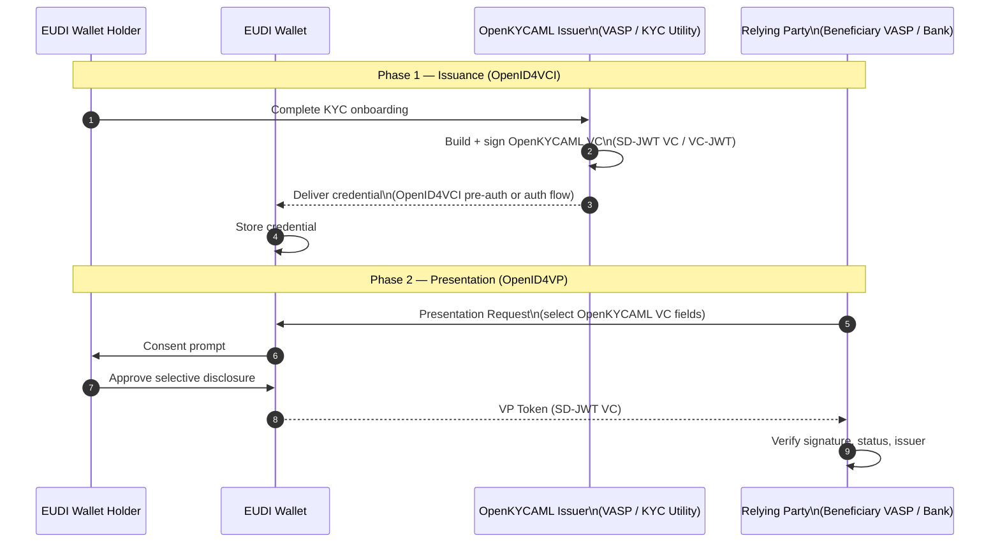
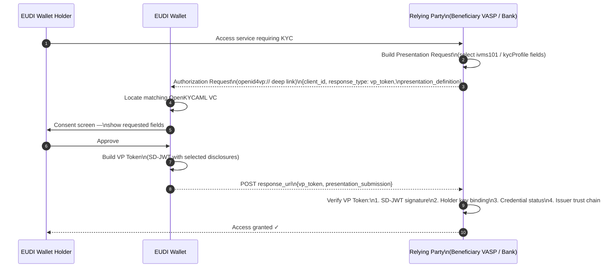
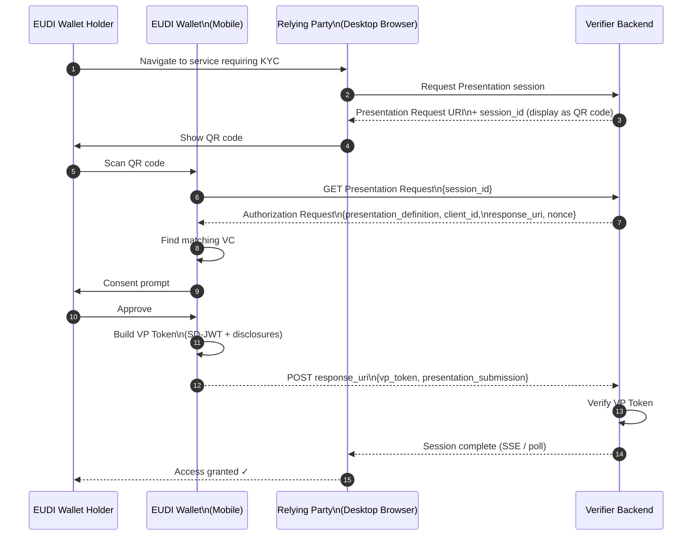
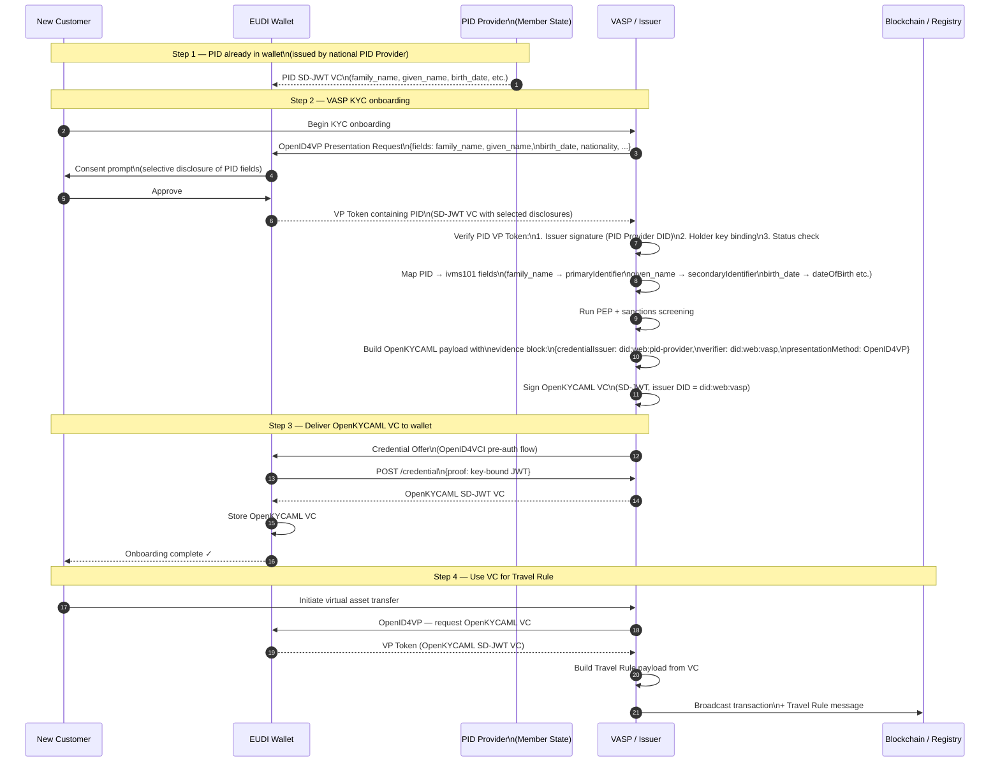

# eIDAS 2.0 VC Issuance and Presentation Flows — Sequence Diagrams

This document contains Mermaid sequence diagrams for the eIDAS 2.0 OpenKYCAML Verifiable Credential lifecycle: issuance via **OpenID4VCI** and presentation via **OpenID4VP**.

For narrative integration guidance, see the [EUDI Wallet Integration Guide](../guides/eudi-wallet-integration.md).

---

## Table of Contents

1. [Overview: OpenKYCAML VC Lifecycle](#1-overview-openkycaml-vc-lifecycle)
2. [VC Issuance — OpenID4VCI Pre-Authorised Code Flow](#2-vc-issuance--openid4vci-pre-authorised-code-flow)
3. [VC Issuance — OpenID4VCI Authorisation Code Flow](#3-vc-issuance--openid4vci-authorisation-code-flow)
4. [VC Presentation — OpenID4VP (Same-Device)](#4-vc-presentation--openid4vp-same-device)
5. [VC Presentation — OpenID4VP (Cross-Device / QR Code)](#5-vc-presentation--openid4vp-cross-device--qr-code)
6. [SD-JWT Selective Disclosure Flow](#6-sd-jwt-selective-disclosure-flow)
7. [Credential Status Check (StatusList2021)](#7-credential-status-check-statuslist2021)
8. [PID-Backed OpenKYCAML Issuance (Full EUDI Wallet Onboarding)](#8-pid-backed-openkycaml-issuance-full-eudi-wallet-onboarding)

---

## 1. Overview: OpenKYCAML VC Lifecycle



---

## 2. VC Issuance — OpenID4VCI Pre-Authorised Code Flow

Used when the issuer pre-approves the credential offer (e.g., after in-person or online KYC). The EUDI Wallet scans a QR code or deep-links to the credential offer URI.

```mermaid
sequenceDiagram
    autonumber
    participant Holder as EUDI Wallet Holder
    participant Wallet as EUDI Wallet
    participant Issuer as OpenKYCAML Issuer
    participant AuthServer as Authorisation Server

    Issuer->>Issuer: KYC completed; build\nOpenKYCAML payload + sign VC
    Issuer->>Holder: Credential Offer URI\n(QR code / deep link)\nopenid-credential-offer://?credential_offer=...
    Holder->>Wallet: Open credential offer
    Wallet->>Issuer: GET /.well-known/openid-credential-issuer\n(fetch issuer metadata)
    Issuer-->>Wallet: Credential Issuer Metadata\n{credential_configurations_supported, ...}
    Wallet->>AuthServer: POST /token\n{grant_type: urn:...pre-authorized_code,\npre-authorized_code, tx_code}
    AuthServer-->>Wallet: Access Token + c_nonce
    Wallet->>Wallet: Generate key-bound proof\n(JWT with c_nonce)
    Wallet->>Issuer: POST /credential\n{format: dc+sd-jwt,\ncredential_identifier,\nproof: {jwt}}
    Issuer->>Issuer: Verify holder key binding;\nbind VC to wallet key (cnf.jwk)
    Issuer-->>Wallet: Credential Response\n{credential: <SD-JWT VC>}
    Wallet->>Wallet: Store OpenKYCAML VC
    Wallet-->>Holder: Credential stored ✓
```

---

## 3. VC Issuance — OpenID4VCI Authorisation Code Flow

Used when the holder must authenticate with the issuer before receiving the credential (e.g., existing customer account login).

```mermaid
sequenceDiagram
    autonumber
    participant Holder as EUDI Wallet Holder
    participant Wallet as EUDI Wallet
    participant Issuer as OpenKYCAML Issuer
    participant AuthServer as Authorisation Server

    Holder->>Wallet: Request OpenKYCAML credential\nfrom issuer
    Wallet->>Issuer: GET /.well-known/openid-credential-issuer
    Issuer-->>Wallet: Issuer Metadata
    Wallet->>AuthServer: Authorisation Request\n{response_type: code,\nclient_id, redirect_uri,\nscope / authorization_details}
    AuthServer->>Holder: Authentication + consent screen
    Holder->>AuthServer: Authenticate + approve
    AuthServer-->>Wallet: Authorisation Code\n(redirect)
    Wallet->>AuthServer: POST /token\n{grant_type: authorization_code, code}
    AuthServer-->>Wallet: Access Token + c_nonce
    Wallet->>Wallet: Generate key-bound proof\n(JWT signed with wallet key)
    Wallet->>Issuer: POST /credential\n{format: dc+sd-jwt, proof}
    Issuer->>Issuer: Verify proof; build VC;\nbind to holder key
    Issuer-->>Wallet: Credential Response\n{credential: <SD-JWT VC>}
    Wallet->>Wallet: Store credential
    Wallet-->>Holder: Credential stored ✓
```

---

## 4. VC Presentation — OpenID4VP (Same-Device)

Used when the verifier and the EUDI Wallet are on the same device (e.g., browser + mobile wallet via universal link).



---

## 5. VC Presentation — OpenID4VP (Cross-Device / QR Code)

Used when the relying party is on a desktop browser and the EUDI Wallet is on the holder's mobile device.



---

## 6. SD-JWT Selective Disclosure Flow

Illustrates how the EUDI Wallet selectively discloses only the fields requested by the verifier, protecting GDPR-sensitive fields not required for the use case.

```mermaid
sequenceDiagram
    autonumber
    participant Verifier as Relying Party
    participant Wallet as EUDI Wallet
    participant Holder as Holder

    Note over Wallet: Stored SD-JWT VC contains\ndisclosures for all fields:\n- name (required)\n- dateOfBirth\n- nationality\n- kycProfile.customerRiskRating\n- kycProfile.pepStatus\n- kycProfile.sourceOfFunds

    Verifier-->>Wallet: Presentation Request\n{fields: [name, dateOfBirth]\n— travel-rule minimum}
    Wallet->>Holder: Consent: share name + dateOfBirth?
    Holder->>Wallet: Approve
    Wallet->>Wallet: Include ONLY matching disclosures\nin VP Token;\nomit nationality, kycProfile fields
    Wallet-->>Verifier: VP Token\n(SD-JWT ~ name_disclosure ~ dob_disclosure)
    Verifier->>Verifier: Hash disclosures;\nmatch _sd digests;\nverify — only disclosed fields visible
    Note over Verifier: nationality, kycProfile fields\nnot disclosed — GDPR minimisation ✓
```

---

## 7. Credential Status Check (StatusList2021)

Shows the revocation check flow using W3C Status List 2021, which is embedded in the `credentialStatus` field of the OpenKYCAML VC.

```mermaid
sequenceDiagram
    autonumber
    participant Verifier as Relying Party
    participant StatusEndpoint as Status List Endpoint\n(Issuer infrastructure)

    Verifier->>Verifier: Parse VP Token;\nextract credentialStatus.id\n(e.g. https://issuer.example.com/status/1#42)
    Verifier->>StatusEndpoint: GET /status/1\n(fetch Status List JWT)
    StatusEndpoint-->>Verifier: Status List JWT\n(compressed bitstring)
    Verifier->>Verifier: Decompress bitstring;\ncheck bit at index 42
    alt Bit = 0 (not revoked)
        Verifier->>Verifier: Credential is VALID ✓
    else Bit = 1 (revoked)
        Verifier->>Verifier: Credential is REVOKED ✗\nreject presentation
    end
```

---

## 8. PID-Backed OpenKYCAML Issuance (Full EUDI Wallet Onboarding)

End-to-end flow for a new customer who uses their eIDAS 2.0 PID (Personal Identification Data) credential to onboard with a VASP. The VASP verifies the PID and issues an OpenKYCAML VC back to the wallet, recording the evidence chain.



---

*All diagrams are rendered with [Mermaid](https://mermaid.js.org/). For the Travel Rule protocol-specific flows, see [Travel Rule Sequence Diagrams](travel-rule-sequence-diagrams.md). Last updated: v1.3.0.*
