```mermaid
erDiagram
    OpenKYCAMLDocument {
        string schemaVersion
        string messageId
        string messageDateTime
        string messageType
    }

    IVMS101Payload {
        string transactionIdentifier
        string timestamp
        string version
        string amount
        string assetType
    }

    Originator {
        string accountNumber
    }

    Beneficiary {
        string accountNumber
    }

    VASP {
        string name
        string vaspIdentifier
        string lei
    }

    NaturalPerson {
        string customerIdentification
        string countryOfResidence
        string nationality
    }

    LegalPerson {
        string customerNumber
        string lei
        string countryOfRegistration
    }

    NaturalPersonNameIdentifier {
        string primaryIdentifier
        string secondaryIdentifier
        string nameIdentifierType
    }

    LegalPersonNameIdentifier {
        string legalPersonName
        string legalPersonNameIdentifierType
    }

    Address {
        string addressType
        string streetName
        string buildingNumber
        string townName
        string postCode
        string country
    }

    NationalIdentification {
        string nationalIdentifier
        string nationalIdentifierType
        string countryOfIssue
        string registrationAuthority
    }

    DateAndPlaceOfBirth {
        string dateOfBirth
        string placeOfBirth
    }

    LegalPersonIdentificationData {
        string currentLegalName
        string uniqueIdentifier
        string vatRegistrationNumber
        string taxReferenceNumber
        string europeanUniqueIdentifier
        string lei
        string eoriNumber
    }

    VerifiableCredentialWrapper {
        string id
        string issuanceDate
        string expirationDate
    }

    VerifiableCredentialProof {
        string type
        string created
        string verificationMethod
        string proofPurpose
        string proofValue
        string jws
    }

    KYCProfile {
        string customerRiskRating
        string dueDiligenceType
        string onboardingChannel
        string kycCompletionDate
        string jurisdictionOfService
    }

    PEPStatus {
        boolean isPEP
        string pepCategory
        string pepRole
        string screeningDate
        string screeningProvider
    }

    SanctionsScreening {
        string screeningStatus
        string screeningDate
        string screeningProvider
    }

    AdverseMedia {
        boolean hasHits
        string screeningStatus
        string screeningDate
        string screeningProvider
        string summary
    }

    SourceOfFundsWealth {
        string verificationStatus
        string sourceOfWealthNarrative
    }

    BeneficialOwner {
        number ownershipPercentage
        string ownershipType
        string controlMechanism
        string verificationDate
        boolean isPEP
        integer ownershipChainDepth
    }

    MonitoringInfo {
        string monitoringLevel
        string monitoringStatus
        boolean eddRequired
        string lastReviewDate
        string nextReviewDate
        string reviewFrequency
    }

    AuditMetadata {
        string recordId
        string recordCreatedAt
        string recordUpdatedAt
        integer recordVersion
        string createdBy
        string dataSourceSystem
        string dataProvider
        string dataRetentionDate
    }

    GdprSensitivityMetadata {
        string classification
        boolean tippingOffProtected
        string legalBasis
        string retentionPeriod
        string auditReference
    }

    SelectiveDisclosure {
        string sd_alg
    }

    %% Root document contains the main payload blocks
    OpenKYCAMLDocument ||--o| IVMS101Payload : "ivms101"
    OpenKYCAMLDocument ||--o| VerifiableCredentialWrapper : "verifiableCredential"

    %% IVMS 101 composition
    IVMS101Payload ||--|| Originator : "originator"
    IVMS101Payload ||--|| Beneficiary : "beneficiary"
    IVMS101Payload ||--|| VASP : "originatingVASP"
    IVMS101Payload ||--|| VASP : "beneficiaryVASP"
    IVMS101Payload ||--o{ VASP : "transferPath"

    %% Originator / Beneficiary persons
    Originator ||--o{ NaturalPerson : "originatorPersons.naturalPerson"
    Originator ||--o{ LegalPerson : "originatorPersons.legalPerson"
    Beneficiary ||--o{ NaturalPerson : "beneficiaryPersons.naturalPerson"
    Beneficiary ||--o{ LegalPerson : "beneficiaryPersons.legalPerson"

    %% NaturalPerson sub-entities
    NaturalPerson ||--o{ NaturalPersonNameIdentifier : "name.nameIdentifier"
    NaturalPerson ||--o{ Address : "geographicAddress"
    NaturalPerson ||--o| NationalIdentification : "nationalIdentification"
    NaturalPerson ||--o| DateAndPlaceOfBirth : "dateAndPlaceOfBirth"

    %% LegalPerson sub-entities
    LegalPerson ||--o{ LegalPersonNameIdentifier : "name.nameIdentifier"
    LegalPerson ||--o{ Address : "geographicAddress"
    LegalPerson ||--o| NationalIdentification : "nationalIdentification"
    LegalPerson ||--o| LegalPersonIdentificationData : "lpid"

    %% LegalPersonIdentificationData sub-entities
    LegalPersonIdentificationData ||--o| Address : "currentAddress"
    LegalPersonIdentificationData ||--o{ NaturalPerson : "mandates.naturalPerson"

    %% VC Wrapper composition
    VerifiableCredentialWrapper ||--o| IVMS101Payload : "credentialSubject.ivms101"
    VerifiableCredentialWrapper ||--o| KYCProfile : "credentialSubject.kycProfile"
    VerifiableCredentialWrapper ||--o| LegalPersonIdentificationData : "credentialSubject.lpid"
    VerifiableCredentialWrapper ||--o| VerifiableCredentialProof : "proof"
    VerifiableCredentialWrapper ||--o| SelectiveDisclosure : "selectiveDisclosure"

    %% KYC Profile composition
    KYCProfile ||--o| PEPStatus : "pepStatus"
    KYCProfile ||--o| SanctionsScreening : "sanctionsScreening"
    KYCProfile ||--o| AdverseMedia : "adverseMedia"
    KYCProfile ||--o| SourceOfFundsWealth : "sourceOfFundsWealth"
    KYCProfile ||--o{ BeneficialOwner : "beneficialOwners"
    KYCProfile ||--o| MonitoringInfo : "monitoringInfo"
    KYCProfile ||--o| AuditMetadata : "auditMetadata"
    KYCProfile ||--o| GdprSensitivityMetadata : "gdprSensitivityMetadata"

    %% BeneficialOwner references persons
    BeneficialOwner ||--o| NaturalPerson : "person.naturalPerson"
    BeneficialOwner ||--o| LegalPerson : "person.legalPerson"
    BeneficialOwner ||--o{ LegalPerson : "intermediateEntities.legalPerson"
```

# OpenKYCAML Full Schema — Entity-Relationship Diagram

This document presents a Mermaid entity-relationship diagram of the complete OpenKYCAML v1.3.0 schema. Each box represents a `$defs` entity or top-level object; relationships show `$ref` references and composition.

---

---

## Entity Descriptions

| Entity | Description |
|---|---|
| `OpenKYCAMLDocument` | Root document envelope. At least one of `ivms101` or `verifiableCredential` must be present. |
| `IVMS101Payload` | IVMS 101 Travel Rule message payload (FATF Rec 16 / TFR 2023). |
| `Originator` | Sending party in a virtual asset transfer. |
| `Beneficiary` | Receiving party in a virtual asset transfer. |
| `VASP` | Virtual Asset Service Provider identifier. |
| `NaturalPerson` | IVMS 101 natural person entity (individual). |
| `LegalPerson` | IVMS 101 legal person entity (company/organisation). |
| `NaturalPersonNameIdentifier` | Structured name for a natural person (family/given names). |
| `LegalPersonNameIdentifier` | Registered name for a legal person. |
| `Address` | Structured postal address (IVMS 101 §3.5). |
| `NationalIdentification` | National identification document (passport, LEI, etc.). |
| `DateAndPlaceOfBirth` | Birth information for a natural person. |
| `LegalPersonIdentificationData` | eIDAS 2.0 LPID block for legal entities. |
| `VerifiableCredentialWrapper` | W3C Verifiable Credential envelope (VC Data Model v2). |
| `VerifiableCredentialProof` | Cryptographic proof (Ed25519, JsonWebSignature2020, etc.). |
| `SelectiveDisclosure` | SD-JWT selective disclosure metadata. |
| `KYCProfile` | KYC/AML profile — risk rating, screening results, UBO chain. |
| `PEPStatus` | Politically Exposed Person screening result. |
| `SanctionsScreening` | Sanctions list screening result. |
| `AdverseMedia` | Adverse media / negative news screening result. |
| `SourceOfFundsWealth` | Declared and verified source of funds and wealth. |
| `BeneficialOwner` | Ultimate Beneficial Owner (UBO) record with ownership chain. |
| `MonitoringInfo` | Ongoing AML monitoring metadata and alerts. |
| `AuditMetadata` | Audit trail and provenance metadata. |
| `GdprSensitivityMetadata` | GDPR/AML sensitivity classification and tipping-off protection. |

---

*Diagram generated from OpenKYCAML schema v1.3.0. Last updated: v1.3.0.*
