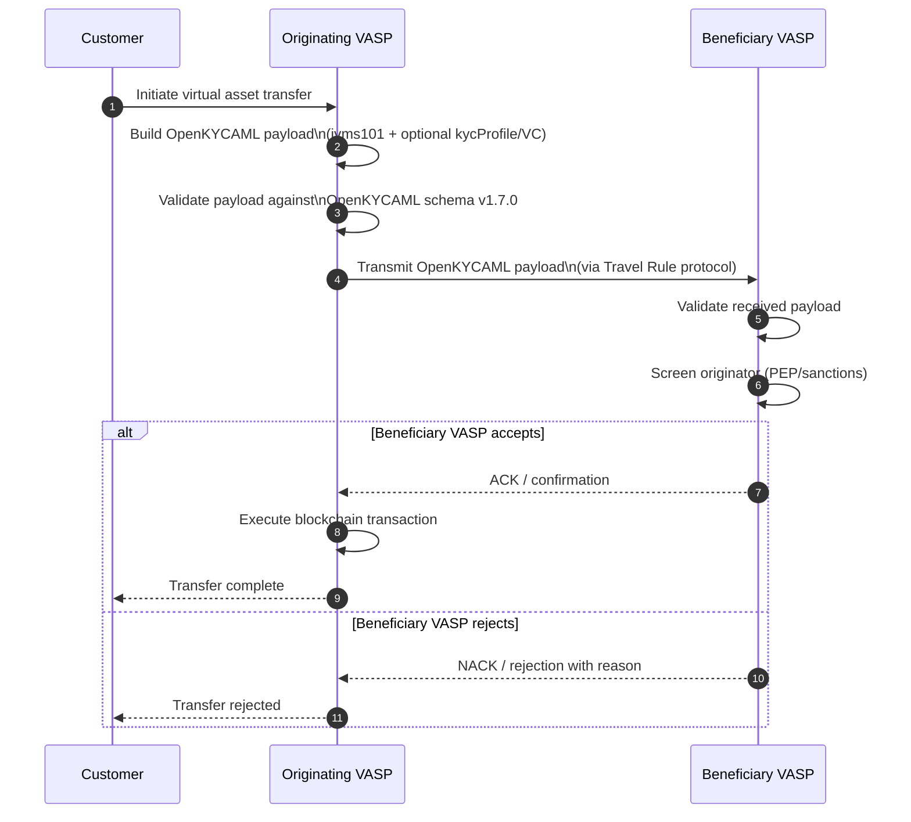

# Travel Rule Message Flow — Sequence Diagrams

This document contains Mermaid sequence diagrams for the five major Travel Rule protocols supported by OpenKYCAML: **TRISA**, **OpenVASP**, **Notabene / DAP**, **TRP (SWIFT)**, and **Sygna Bridge**.

For protocol integration code, see the [Travel Rule Implementation Guide](../guides/travel-rule-implementation-guide.md).

---

## Table of Contents

1. [Generic OpenKYCAML Travel Rule Flow](#1-generic-openkycaml-travel-rule-flow)
2. [TRISA Flow](#2-trisa-flow)
3. [OpenVASP Flow](#3-openvasp-flow)
4. [Notabene / DAP Flow](#4-notabene--dap-flow)
5. [TRP — SWIFT Travel Rule Protocol Flow](#5-trp--swift-travel-rule-protocol-flow)
6. [Sygna Bridge Flow](#6-sygna-bridge-flow)
7. [eIDAS 2.0 EUDI Wallet Enhanced Travel Rule Flow](#7-eidas-20-eudi-wallet-enhanced-travel-rule-flow)

---

## 1. Generic OpenKYCAML Travel Rule Flow

The following diagram shows the protocol-agnostic exchange pattern common to all Travel Rule integrations using OpenKYCAML.



---

## 2. TRISA Flow

TRISA uses mutual TLS (mTLS) and gRPC. VASPs register in the TRISA Global Directory Service (GDS). The OpenKYCAML `ivms101` block maps directly to the TRISA `IdentityPayload` protobuf message.

```mermaid
sequenceDiagram
    autonumber
    participant Customer as Customer
    participant OrigVASP as Originating VASP
    participant GDS as TRISA GDS
    participant BeneVASP as Beneficiary VASP
    participant Blockchain as Blockchain

    Customer->>OrigVASP: Initiate transfer (asset, amount, beneficiary address)
    OrigVASP->>GDS: Lookup beneficiary VASP\n(address / DID resolution)
    GDS-->>OrigVASP: Beneficiary VASP endpoint + mTLS certificate
    OrigVASP->>OrigVASP: Build OpenKYCAML payload;\nextract ivms101 block
    OrigVASP->>OrigVASP: Encrypt payload in TRISA\nSecureEnvelope (RSA/AES)
    OrigVASP->>BeneVASP: gRPC Transfer(SecureEnvelope)\nvia mTLS
    BeneVASP->>BeneVASP: Decrypt SecureEnvelope;\nvalidate ivms101
    BeneVASP->>BeneVASP: Screen originator
    BeneVASP-->>OrigVASP: gRPC Transfer response\n(sealed SecureEnvelope)
    OrigVASP->>Blockchain: Broadcast transaction
    Blockchain-->>OrigVASP: Transaction hash confirmed
    OrigVASP-->>Customer: Transfer complete
```

---

## 3. OpenVASP Flow

OpenVASP is a peer-to-peer JSON protocol using Ethereum-based VASP discovery (VASP Index smart contract) and Whisper/Waku or HTTPS transport.

```mermaid
sequenceDiagram
    autonumber
    participant Customer as Customer
    participant OrigVASP as Originating VASP
    participant EthIndex as Ethereum VASP Index
    participant BeneVASP as Beneficiary VASP
    participant Blockchain as Blockchain

    Customer->>OrigVASP: Initiate transfer
    OrigVASP->>EthIndex: Resolve beneficiary VASP\nfrom destination address (VAAN)
    EthIndex-->>OrigVASP: Beneficiary VASP metadata\n(transport endpoint, signing key)
    OrigVASP->>OrigVASP: Build OpenKYCAML payload;\nextract ivms101 block
    OrigVASP->>BeneVASP: Session Request (type 110)\nwith originator ivms101 + VAAN
    BeneVASP-->>OrigVASP: Session Reply (type 150)\nwith beneficiary ivms101
    OrigVASP->>OrigVASP: Validate beneficiary details
    OrigVASP->>BeneVASP: Transfer Request (type 210)
    BeneVASP-->>OrigVASP: Transfer Reply (type 250) — accept/reject
    alt Transfer accepted
        OrigVASP->>Blockchain: Broadcast transaction
        Blockchain-->>OrigVASP: Confirmation
        OrigVASP->>BeneVASP: Transfer Dispatch (type 310)\nwith transaction hash
        BeneVASP-->>OrigVASP: Transfer Confirmation (type 350)
        OrigVASP-->>Customer: Transfer complete
    else Transfer rejected
        OrigVASP-->>Customer: Transfer rejected
    end
```

---

## 4. Notabene / DAP Flow

Notabene provides a managed Travel Rule API. The originating VASP posts the IVMS 101 payload via REST. Beneficiary VASP discovery uses DAP (`@` addressing) or the Notabene directory.

```mermaid
sequenceDiagram
    autonumber
    participant Customer as Customer
    participant OrigVASP as Originating VASP
    participant NotabeneAPI as Notabene API
    participant BeneVASP as Beneficiary VASP
    participant Blockchain as Blockchain

    Customer->>OrigVASP: Initiate transfer
    OrigVASP->>OrigVASP: Build OpenKYCAML payload;\nextract ivms101 block
    OrigVASP->>NotabeneAPI: POST /api/v1/transfers\n{ivms101, origin_address, destination_address, ...}
    NotabeneAPI->>NotabeneAPI: Resolve beneficiary VASP\nvia Notabene directory / DAP
    NotabeneAPI->>BeneVASP: Forward Travel Rule request\n(JSON, ivms101)
    BeneVASP->>BeneVASP: Screen originator; validate data
    BeneVASP-->>NotabeneAPI: Accept / Reject response
    NotabeneAPI-->>OrigVASP: Transfer status update
    alt Accepted
        OrigVASP->>Blockchain: Broadcast transaction
        Blockchain-->>OrigVASP: Confirmation
        OrigVASP->>NotabeneAPI: PATCH /api/v1/transfers/{id}\n{transactionHash}
        OrigVASP-->>Customer: Transfer complete
    else Rejected
        OrigVASP-->>Customer: Transfer rejected
    end
```

---

## 5. TRP — SWIFT Travel Rule Protocol Flow

TRP is a REST-based protocol aligned with SWIFT. Financial institutions using SWIFT can additionally produce ISO 20022 pacs.008 XML with the OpenKYCAML envelope embedded in `<SplmtryData>`.

```mermaid
sequenceDiagram
    autonumber
    participant Customer as Customer
    participant OrigVASP as Originating VASP / FI
    participant TRPDir as TRP Directory
    participant BeneVASP as Beneficiary VASP / FI
    participant Blockchain as Blockchain

    Customer->>OrigVASP: Initiate transfer
    OrigVASP->>TRPDir: Resolve beneficiary VASP endpoint
    TRPDir-->>OrigVASP: Endpoint URL + public key
    OrigVASP->>OrigVASP: Build OpenKYCAML payload;\nextract ivms101 → ivmsData
    Note over OrigVASP: Optionally produce\npacs.008 XML via\nISO 20022 converter
    OrigVASP->>BeneVASP: POST /transfers\n{assetType, ivmsData, originatorRef, beneficiaryRef}
    BeneVASP->>BeneVASP: Validate ivmsData;\nscreen originator
    BeneVASP-->>OrigVASP: HTTP 200 OK (accepted)\nor 4xx (rejected)
    alt Accepted
        OrigVASP->>Blockchain: Broadcast transaction
        Blockchain-->>OrigVASP: Confirmation
        OrigVASP->>BeneVASP: PATCH /transfers/{id}\n{transactionHash, status: "COMPLETED"}
        OrigVASP-->>Customer: Transfer complete
    else Rejected
        OrigVASP-->>Customer: Transfer rejected
    end
```

---

## 6. Sygna Bridge Flow

Sygna Bridge is a commercial hub operated by CoolBitX. VASP-to-VASP data is ECIES-encrypted and routed via the Sygna Bridge API. Sygna uses `snake_case` IVMS 101 field names (protobuf convention); the OpenKYCAML converter handles the camelCase → snake_case transformation.

```mermaid
sequenceDiagram
    autonumber
    participant Customer as Customer
    participant OrigVASP as Originating VASP
    participant SygnaAPI as Sygna Bridge API
    participant BeneVASP as Beneficiary VASP
    participant Blockchain as Blockchain

    Customer->>OrigVASP: Initiate transfer
    OrigVASP->>OrigVASP: Build OpenKYCAML payload;\nextract ivms101;\nconvert camelCase → snake_case
    OrigVASP->>SygnaAPI: GET /v2/vasp/beneficiary\n(resolve beneficiary VASP ECIES key)
    SygnaAPI-->>OrigVASP: Beneficiary VASP public key
    OrigVASP->>OrigVASP: ECIES-encrypt private_info\n(ivms101 snake_case)
    OrigVASP->>SygnaAPI: POST /v2/transaction/permission-request\n{private_info (encrypted), data_dt, ...}
    SygnaAPI->>BeneVASP: Forward permission request
    BeneVASP->>BeneVASP: Decrypt private_info;\nvalidate originator; screen
    BeneVASP-->>SygnaAPI: POST /v2/transaction/permission\n{permission_status: ACCEPTED/REJECTED}
    SygnaAPI-->>OrigVASP: Permission status
    alt Accepted
        OrigVASP->>Blockchain: Broadcast transaction
        Blockchain-->>OrigVASP: Transaction hash confirmed
        OrigVASP->>SygnaAPI: POST /v2/transaction/txid\n{txid, signature}
        OrigVASP-->>Customer: Transfer complete
    else Rejected
        OrigVASP-->>Customer: Transfer rejected
    end
```

---

## 7. eIDAS 2.0 EUDI Wallet Enhanced Travel Rule Flow

When the originator has an EUDI Wallet, a PID Verifiable Credential can be included in the OpenKYCAML payload as the `evidence` block, providing high-assurance identity triangulation.

```mermaid
sequenceDiagram
    autonumber
    participant Customer as EUDI Wallet Holder
    participant EUDIWallet as EUDI Wallet
    participant OrigVASP as Originating VASP
    participant BeneVASP as Beneficiary VASP
    participant Blockchain as Blockchain

    Customer->>OrigVASP: Initiate transfer
    OrigVASP->>EUDIWallet: OpenID4VP Presentation Request\n(request PID attributes)
    EUDIWallet->>Customer: Consent prompt —\nselective disclosure of PID fields
    Customer->>EUDIWallet: Approve disclosure
    EUDIWallet-->>OrigVASP: VP Token (SD-JWT VC)\ncontaining PID attributes
    OrigVASP->>OrigVASP: Verify VP signature;\nmap PID → ivms101 fields;\nbuild OpenKYCAML payload\nwith evidence block
    Note over OrigVASP: evidence[] records:\n- PID Issuer DID\n- VASP verifier DID\n- presentationMethod: OpenID4VP\n- presentationDate
    OrigVASP->>BeneVASP: Transmit OpenKYCAML payload\n(via Travel Rule protocol)
    BeneVASP->>BeneVASP: Validate payload;\nverify evidence chain;\nscreen originator
    BeneVASP-->>OrigVASP: ACK
    OrigVASP->>Blockchain: Broadcast transaction
    Blockchain-->>OrigVASP: Confirmation
    OrigVASP-->>Customer: Transfer complete
```

---

*All diagrams are rendered with [Mermaid](https://mermaid.js.org/). Last updated: v1.7.0.*
